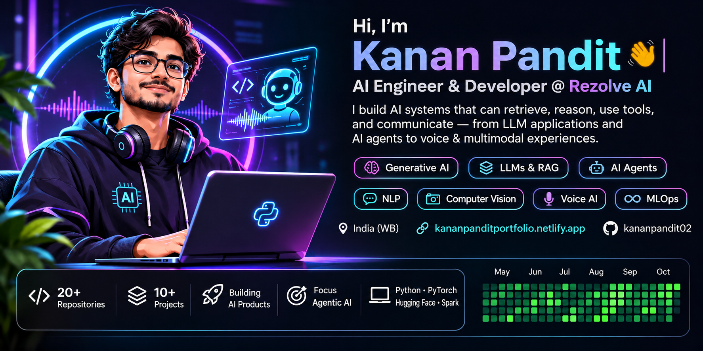

<!--
  Kanan Pandit | GitHub Profile
  Focus: production GenAI, agentic systems, retrieval and Voice AI.
-->

# Kanan Pandit

### AI/ML Engineer · Generative AI · Agentic Systems · Voice AI

**I build AI systems that can retrieve, reason, use tools, and communicate.**

  <a href="https://kananpanditportfolio.netlify.app/">Portfolio</a> ·
  <a href="https://www.linkedin.com/in/kananpandit02/">LinkedIn</a> ·
  <a href="mailto:kananpandit02@gmail.com">Email</a>

---

## What I work on

I’m an **AI/ML Engineer at Rezolve AI**, working on practical Generative AI and conversational systems. My work spans LLM-powered agents, retrieval-augmented generation, agent orchestration, API and tool integration, and real-time voice experiences.

I’m especially interested in the engineering behind dependable AI products: **how agents coordinate, retrieve useful context, handle multi-step tasks, and remain reliable in real user conversations.**

| Focus area | What I build and explore |
|---|---|
| **Agentic AI** | Multi-agent workflows, orchestration, tool calling and task execution |
| **LLM Applications** | Prompt design, structured outputs, context handling and evaluation |
| **RAG & GraphRAG** | Document retrieval, semantic search, FAISS, BM25 and knowledge graphs |
| **Voice AI** | Conversational interfaces, speech pipelines and real-time interaction |
| **ML & Computer Vision** | Predictive modeling, deep learning and image understanding |
| **AI Engineering** | Python services, API integration, debugging, testing and reliability |

## Selected work

A selection of projects across Generative AI, retrieval, machine learning and computer vision.

### Generative AI & Retrieval

| Project | What it explores |
|---|---|
| [**GraphRAG QA**](https://github.com/kananpandit02/GRAPHRAG_QA) | Multi-document question answering with lexical retrieval, vector search and knowledge-graph reasoning |
| [**RAG Q&A**](https://github.com/kananpandit02/rag_qna) | Retrieval-augmented question answering |
| [**RAG 300ms**](https://github.com/kananpandit02/rag_300ms) | Low-latency retrieval-augmented generation experimentation |

### Machine Learning & Computer Vision

| Project | What it explores |
|---|---|
| [**Wildfire Prediction with H2O**](https://github.com/kananpandit02/wildfire_pred_h2o) | Distributed machine learning with H2O and satellite-observed fire data |
| [**CycleGAN Streamlit**](https://github.com/kananpandit02/cyclegan-streamlit) | Image-to-image translation with a CycleGAN application |
| [**EMNIST Classification**](https://github.com/kananpandit02/emnist_classification) | Comparative classification of handwritten characters |
| [**Hand Gesture Control**](https://github.com/kananpandit02/hand_gesture_control) | Computer-vision-based gesture interaction |

[Explore all repositories →](https://github.com/kananpandit02?tab=repositories)

## Experience

**AI/ML Engineer — Rezolve AI**  
*January 2026 – Present · Internship followed by full-time role*

- Build and improve conversational AI and agentic workflows for customer-facing product experiences.
- Contribute to voice-based concierge and ordering experiences in hospitality and food-service scenarios.
- Work across agent orchestration, API integrations, tools, memory and multi-step workflows.
- Implement and test loyalty-related assistant capabilities, including points, rewards and redemption flows.
- Investigate conversation-flow issues, latency and reliability across voice interactions.

## Technology toolkit

**Languages & backend**  
Python · SQL · FastAPI · Django REST · REST APIs

**Generative AI & orchestration**  
LLMs · LangGraph · LangChain · RAG · Tool Calling · Prompt Engineering

**Retrieval, data & graphs**  
FAISS · Sentence Transformers · BM25 · Neo4j · Apache Spark · NetworkX

**Machine Learning & vision**  
PyTorch · TensorFlow · Scikit-learn · H2O · OpenCV · NLP · Computer Vision

**Voice & AI systems**  
Pipecat · LiveKit · WebRTC · STT · TTS · Conversational AI

## Education

- **M.Sc. in Big Data Analytics** — Ramakrishna Mission Vivekananda Educational and Research Institute (RKMVERI)
- **B.Sc. in Mathematics (Honours)** — Vidyasagar University

## Beyond the code

I enjoy exploring how research ideas become usable AI products—especially around agentic workflows, retrieval quality, voice interaction, evaluation and system reliability.

## Find me here

  <a href="https://kananpandit02.github.io/">GitHub</a> ·
  <a href="https://kananpanditportfolio.netlify.app/">Portfolio</a> ·
  <a href="https://www.linkedin.com/in/kananpandit02/">LinkedIn</a> ·
  <a href="mailto:kananpandit02@gmail.com">Email</a>

  <i>Building practical AI systems, one problem at a time.</i>

